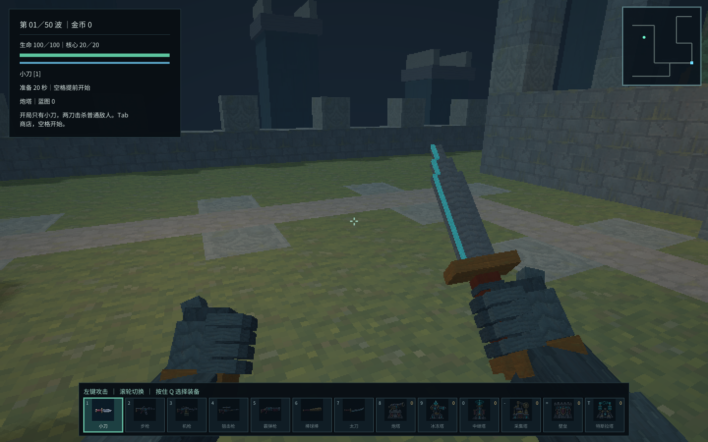

# 余烬守望 · Ember Warden

个人独立开发的第一人称像素塔防肉鸽项目，使用 C++17、OpenGL 3.3 与自定义战斗及渲染实现。代码和像素材质由本项目在 AI 辅助下制作。开源依赖许可证保存在 `licenses`。



## 项目展示

- 源码涵盖战斗、敌人行为与网格寻路、塔防建造、商店经济、强化与套装联动、渲染、合成音效及三语界面。
- 2026-11-20 本机验证：52 项测试、97,032 次断言通过；Windows 试玩程序完成 60 帧启动与渲染检查。
- [Windows 试玩下载](https://github.com/stmoon1/ember-warden/releases/latest)。下载并解压完整试玩包后运行 `Citadel.exe`；源码仓库不包含构建输出。
- 当前敌人逻辑为规则与网格寻路，尚未接入强化学习训练。

直接运行 `playable-v3/Citadel.exe`。Windows x64，需要支持 OpenGL 3.3 的显卡驱动与 Microsoft Visual C++ 2015–2022 x64 运行库。

启动后默认全屏，先进入主页面，点击“开始游戏”后选择角色进入战场。默认鼠标灵敏度为 0.50 倍，可在设置中调节；F11 切换全屏与窗口。Esc / P 暂停，Tab 打开图片商店。商店按武器类别分栏，点击图片卡片查看详情，在右侧购买、装备或补充弹药；防御塔蓝图同样支持图片预览。退出游戏请使用主页面按钮或 Alt+F4。

底部装备栏包含七个武器槽和六个防御塔槽：1～7 选择武器，8、9、0、-、=、T 选择防御塔；滚轮仅在已拥有的武器与剩余蓝图之间切换。按住 Q 释放鼠标，可点击装备栏选择，松开后恢复视角。手持武器时左键攻击，手持蓝图时左键或 E 放置；蓝图用完会自动切回此前的武器。绿色地面框表示可建造，红色表示不可建造，并有完整塔体线框预览。小刀采用单手正握，太刀和球棒采用双手握持，枪械分别设置握把手与护木支撑手。

- [操作与数值](GAME_GUIDE.md)
- [12 类怪物图鉴](MONSTERS.md)
- [128 项强化目录](UPGRADES.md)
- [10 套组合奖励](SETS.md)
- [素材制作记录](ASSET_CREDITS.md)
- [发布准备](RELEASE_NOTES.md)

## 当前内容

50 波战役、角色选择、七种武器、六种防御塔、128 项金银铜三选一强化、每五波首领三金奖励、三路进攻、飞行与特殊敌人。默认中文，可切换英语和日语。像素遗迹、掩体、庭院、城墙、水晶、火把、实时阴影、局部光照与像素发光统一渲染。角色与怪物具有分层护甲、装备和差异化轮廓，界面包含强化类别图标与目标生命显示。打击反馈包含受击闪白、硬直、击退、暴击与元素飘字、弹道、枪口火光、近战刀光、死亡爆裂、镜头震动与实时合成音效。

## 构建

```sh
cmake -S . -B build -DBUILD_TESTING=ON
cmake --build build --config Release
ctest --test-dir build -C Release --output-on-failure
```

默认从官方仓库下载 GLFW、GLAD、GLM、Dear ImGui、stb，测试使用 Catch2。可使用 CMake 的 FetchContent 本地源码路径覆盖下载。游戏输出到 `build/Release/Citadel.exe`，独立试玩包位于 `playable-v3`。

## 源码结构

- `src/game` 包含世界、战斗、数值与强化。
- `src/Engine` 管理窗口、相机、资源、输入和界面。
- `src/Renderer` 实现像素渲染、模型、光影与反馈显示。
- `src/Sound` 实现 Windows 实时合成混音。
- `src/Localization` 与 `assets/i18n` 管理中文、英语和日语文本。
- `assets` 保存项目像素图集与着色器。
- `tests` 保存玩法回归测试。

当前已验证 Windows 构建。Linux/macOS 的音频为空实现，其他平台尚待实际编译验收。当前尚无存档；界面支持中文、英语和日语。


主页面新增「强化图鉴」：支持分类、搜索、品质筛选、元素前置条件、套装归属与防御塔升级指南。采集塔基础生命为 90；壁垒默认无反伤，选择「尖刺壁垒」后反弹 50% 所受攻击伤害。

主页面「怪物图鉴」支持按目标筛选、搜索、波次数值预览及应对建议。X 拆塔返还实际建造与升级投入的 60%；F 采集地图上的金币和祝福点。新增专攻水晶、专攻防御塔与专偷采集塔的三类敌人。

采集点只在战斗中且场上存在存活怪物时生成。准备阶段、无怪间隙和清波后隐藏并不可采集；同一波已经领取的采集点不会因再次刷怪而重复生成。
